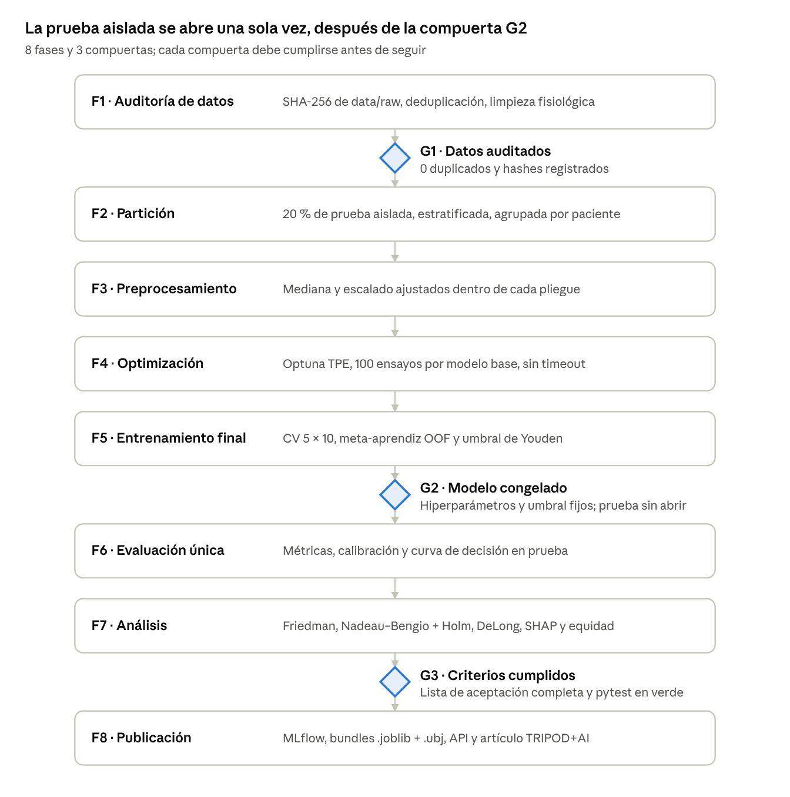

# Hoja de ruta y protocolo de entrenamiento — SP-03 Diabetes XAI

Versión: 2026-11-12

## Alcance

Este protocolo fija cómo se reentrenan y validan los 6 algoritmos del proyecto para que los resultados del artículo sean reproducibles y defendibles ante revisión Q1. Parte del pipeline actual (`scripts/train_and_evaluate_v2.py` y `scripts/benchmark_cross_datasets.py`) y corrige 9 puntos débiles detectados al revisarlo.

- **Resultado 1 (R1), activo:** presencia o aparición de diabetes mellitus tipo 2. Se entrena y valida con datos reales.
- **Resultado 2 (R2), trabajo futuro:** complicaciones crónicas y supervivencia. Ninguna de las 5 cohortes tiene tiempo hasta evento ni censura, así que R2 no se valida; solo se documenta su arquitectura.
- **Algoritmos:** Regresión Logística L2 (línea base), Random Forest, XGBoost, TabNet, Stacking híbrido y modelo híbrido XGBoost + Weibull.
- **Semilla única:** `RANDOM_SEED = 42` para NumPy, PyTorch, scikit-learn, XGBoost, TabNet y Optuna.

Advertencia: es un prototipo académico, no un dispositivo médico (SaMD).

## Hoja de ruta

El entrenamiento avanza en 8 fases y se detiene en 3 compuertas que bloquean el paso siguiente hasta cumplirse.

1. **F1 · Auditoría de datos:** SHA-256 de `data/raw`, deduplicación, limpieza fisiológica.
   - **G1 · Datos auditados:** 0 duplicados y hashes registrados.
2. **F2 · Partición:** 20 % de prueba aislada, estratificada, agrupada por paciente.
3. **F3 · Preprocesamiento:** mediana y escalado ajustados dentro de cada pliegue.
4. **F4 · Optimización:** Optuna TPE, 100 ensayos por modelo base, sin timeout.
5. **F5 · Entrenamiento final:** CV 5 × 10, meta-aprendiz OOF y umbral de Youden.
   - **G2 · Modelo congelado:** hiperparámetros y umbral fijos; prueba sin abrir.
6. **F6 · Evaluación única:** métricas, calibración y curva de decisión en prueba.
7. **F7 · Análisis:** Friedman, Nadeau–Bengio + Holm, DeLong, SHAP y equidad.
   - **G3 · Criterios cumplidos:** lista de aceptación completa y pytest en verde.
8. **F8 · Publicación:** MLflow, bundles `.joblib` + `.ubj`, API y artículo TRIPOD+AI.

Las fases F3 a F5 se repiten por cohorte (NHANES y Pima completas; BRFSS, 130 Hospitals y Sylhet como benchmark). Pregunta abierta: las fechas de cada fase quedan por acordar con el asesor.

## Datos y partición

Solo NHANES y Pima pasan por el pipeline completo (Optuna, 6 modelos, prueba aislada). Las otras 3 cohortes son un benchmark secundario y deben declararse así en el artículo.

| Cohorte | Rol | N analítico | Objetivo | Partición | Hallazgo a corregir |
| --- | --- | --- | --- | --- | --- |
| [CDC NHANES 2017–2018](https://wwwn.cdc.gov/nchs/nhanes/continuousnhanes/default.aspx?BeginYear=2017) | Primaria | 4,829 | `DIQ010 == 1` (diagnóstico médico) | 80/20 por `SEQN` + CV 5 pliegues | HbA1c y glucosa son criterios diagnósticos: el modelo detecta diabetes ya presente, no predice aparición. Pesos muestrales (`WTMEC2YR`) no usados. |
| [Pima Indians](https://api.openml.org/d/37) | Benchmark histórico | 768 | `outcome` (DM a 5 años) | 80/20 + CV 5 pliegues | Ceros imposibles ya pasan a NaN. Solo mujeres ≥21 años. |
| [BRFSS 2015 (50/50)](https://archive.ics.uci.edu/dataset/891/cdc%2Bdiabetes%2Bhealth%2Bindicators) | Poblacional | 70,692 | Diabetes o prediabetes | CV 5 pliegues, sin prueba aislada | 1,635 filas duplicadas exactas. Balance 50/50 artificial: el Brier y el VPP no son trasladables a prevalencia real. |
| [Diabetes 130-US Hospitals](https://archive.ics.uci.edu/dataset/296/diabetes-130-us-hospitals-for-years-1999-2008) | Hospitalaria | 71,515 | Reingreso < 30 días | CV 5 pliegues, 1.er ingreso por `patient_nbr` | 1,545 primeros ingresos terminan en fallecimiento u hospicio (`discharge_disposition_id` 11, 13, 14, 19, 20, 21) y no pueden reingresar: excluirlos. |
| [Early Stage Sylhet](https://archive.ics.uci.edu/dataset/529) | Síntomas tempranos | 520 | `class` Positive | CV 5 pliegues | 269 de 520 filas (52 %) son duplicados exactos; solo hay 251 únicas. Copias en entrenamiento y validación inflan el AUC de 0.997. |

Regla de partición para todas las cohortes: deduplicar primero, luego separar 20 % de prueba aislada estratificada y agrupada por paciente, y no tocarla hasta la evaluación final.

## Preprocesamiento y control de fuga

Todo paso que aprende de los datos se ajusta solo con la partición de entrenamiento de cada pliegue y se aplica después a validación y prueba. El pipeline actual ya cumple esto para la imputación y el escalado.

1. **Limpieza fisiológica antes de partir:** presión diastólica < 30 mmHg y sistólica < 60 mmHg pasan a NaN (NHANES); ceros en glucosa, presión, pliegue, insulina e IMC pasan a NaN (Pima).
2. **Deduplicación antes de partir:** filas exactas duplicadas fuera (Sylhet, BRFSS); un ingreso por paciente (130 Hospitals).
3. **Imputación:** `SimpleImputer(strategy="median")` ajustado por pliegue.
4. **Escalado:** `StandardScaler` por pliegue, solo para Regresión Logística y TabNet; los árboles usan datos sin escalar.
5. **Exclusión de predictores post-diagnóstico:** insulina (`DIQ050`) y antidiabéticos orales (`DIQ070`) nunca entran en X.
6. **Variables sensibles fuera de X:** sexo, raza/etnia e ingreso (`RIAGENDR`, `RIDRETH1`, `INDFMPIR`) solo se usan para auditar equidad.
7. **Desbalance:** `scale_pos_weight` = negativos / positivos del entrenamiento (XGBoost) y `class_weight="balanced_subsample"` (Random Forest). Sin SMOTE, para no alterar la calibración.
8. **Variante sin circularidad (nueva, para NHANES):** reentrenar sin HbA1c ni glucosa, o redefinir el objetivo como diabetes no diagnosticada (sin `DIQ010 == 1` y con HbA1c ≥ 6.5 % o glucosa en ayunas ≥ 126 mg/dL). Sin esto, el artículo no puede hablar de *predicción temprana*.

## Protocolo por algoritmo

Hoy solo XGBoost se optimiza con Optuna; RF y TabNet usan valores fijos. Para una comparación justa, los 4 modelos base reciben el mismo presupuesto: 100 ensayos TPE (`seed=42`), sin `timeout`, maximizando el ROC-AUC en una CV interna de 3 pliegues agrupada.

| Modelo | Configuración actual | Espacio de búsqueda propuesto | Cambio obligatorio |
| --- | --- | --- | --- |
| Regresión Logística L2 (línea base) | `C=1.0`, `class_weight="balanced"`, `max_iter=500` | `C` ∈ [1e-3, 1e2] log | Mantener como referencia en todas las tablas. |
| Random Forest | `n_estimators=220`, `max_depth=8`, `min_samples_leaf=5`, `balanced_subsample` | `n_estimators` 100–500; `max_depth` 4–12; `min_samples_leaf` 1–20; `max_features` {sqrt, 0.5, 0.8} | Optimizar con Optuna. |
| XGBoost | Optuna: 35 ensayos, `timeout=120` s, 3 pliegues; `n_estimators` 100–250, `max_depth` 3–6, `learning_rate` 0.02–0.10, `subsample` y `colsample_bytree` 0.70–0.95, `reg_lambda` 1–5 | Mismo espacio + `min_child_weight` 1–10 y `gamma` 0–5 | Quitar `timeout`: hace que el número de ensayos dependa de la velocidad del equipo y rompe la reproducibilidad. |
| TabNet | `n_d=n_a=8`, `n_steps=3`, `gamma=1.3`, `lr=0.02`, 45 épocas, `patience=10` | `n_d=n_a` {8, 16, 32}; `n_steps` 3–7; `gamma` 1.0–2.0; `lr` 5e-3–5e-2 | El modelo final usa la **prueba aislada** como `eval_set` para la parada temprana: fuga directa. Usar un 10 % interno del entrenamiento. |
| Stacking híbrido | Meta-aprendiz `LogisticRegression(C=1.0)` sobre predicciones out-of-fold de RF, XGB y TabNet | Sin búsqueda | Su AUC de CV se calcula con pesos fijos 0.45 / 0.35 / 0.20, no con el meta-aprendiz: reportar el meta-aprendiz anidado. No se llama «calibrado» salvo que se añada `CalibratedClassifierCV`. |
| Híbrido XGBoost + Weibull | Probabilidad de XGBoost + Weibull con λ = 0.005 y γ = 1.35 fijados a mano | No aplica | λ, γ y el riesgo relativo `exp((p − 0.15) × 3.2)` no se ajustan a datos. En prueba se reporta `0.85 × XGB + 0.15 × Stacking`, pero la API sirve solo XGB. Presentarlo como demostración de R2, no como modelo validado. |

Orden de ejecución por cohorte: partir → optimizar cada modelo dentro del 80 % → CV de 5 pliegues con los hiperparámetros fijos → predicciones out-of-fold para el meta-aprendiz → reentrenar sobre el 80 % completo → evaluar una sola vez en el 20 %.

## Validación y métricas

La cifra principal del artículo es el desempeño en la prueba aislada del 20 %, evaluada una sola vez. El AUC de CV actual es optimista porque Optuna eligió los hiperparámetros con los mismos datos.

- **CV anidada:** bucle externo `StratifiedGroupKFold` de 5 pliegues × 10 repeticiones (50 estimaciones), con Optuna dentro de cada pliegue externo. Si el cómputo no alcanza, declarar el sesgo como limitación.
- **Umbral de decisión:** hoy es 0.5 fijo, con una prevalencia de NHANES cercana al 16 %. Elegirlo con las predicciones out-of-fold del entrenamiento (índice de Youden, o sensibilidad ≥ 80 % para tamizaje) y aplicarlo sin cambios a la prueba.
- **Discriminación:** ROC-AUC y PR-AUC. La PR-AUC es necesaria con clases desbalanceadas.
- **Clasificación en el umbral:** sensibilidad, especificidad, VPP, VPN y F1, con la matriz de confusión.
- **Calibración:** Brier, pendiente e intercepto de calibración, y curva de 10 bins.
- **Utilidad clínica:** curva de decisión (net benefit) entre umbrales de 5 % y 50 %.
- **Reporte:** seguir TRIPOD+AI para modelos predictivos clínicos.

## Comparación estadística

Con 5 pliegues, Wilcoxon de dos colas no puede bajar de p = 0.0625 (verificado con SciPy), así que ninguna comparación por pares del pipeline actual puede salir significativa. Esto explica, junto con Friedman p = 0.290, por qué no hay diferencias entre modelos.

| Prueba | Sobre qué | Configuración del protocolo |
| --- | --- | --- |
| Friedman | AUC de los 6 modelos por pliegue | Sobre las 50 estimaciones de la CV 5 × 10; post-hoc de Nemenyi y diagrama de diferencia crítica. |
| t remuestreada corregida (Nadeau–Bengio) | AUC por pares | Reemplaza a Wilcoxon sobre pliegues, que no son independientes; ajuste de Holm sobre las 15 comparaciones. |
| DeLong | AUC por pares en la prueba aislada | Añadir: es la prueba estándar para comparar dos curvas ROC sobre los mismos pacientes. |
| McNemar con corrección de Edwards | Aciertos por pares en la prueba aislada | Mantener, con el umbral elegido en entrenamiento. |
| Bootstrap B = 1000 | IC 95 % de AUC, F1, sensibilidad y Brier | Mantener; estratificado por clase y con la semilla 42. |

La conclusión se redacta como equivalencia o superioridad solo si la prueba ajustada la respalda; si no, como «sin diferencia detectable».

## Explicabilidad, calibración y equidad

Cada modelo final se explica y audita sobre la prueba aislada, nunca sobre el entrenamiento.

- **SHAP global:** `TreeExplainer` para RF y XGBoost, `LinearExplainer` para la Regresión Logística; reportar la media de |SHAP| por variable y el gráfico beeswarm.
- **SHAP local:** contribuciones por paciente en la API (`/predict`), con la mediana de entrenamiento como referencia.
- **Estabilidad de SHAP (nueva):** repetir sobre 100 remuestreos bootstrap y reportar el ranking medio con su IC. Un orden que cambia entre remuestreos no se interpreta clínicamente.
- **TabNet:** usar su máscara de atención como explicación complementaria y declarar que no equivale a SHAP.
- **Calibración:** si la pendiente se sale de [0.8, 1.2], recalibrar con `CalibratedClassifierCV` (isotónica, `cv=5`) dentro del entrenamiento y reportar ambos resultados.
- **Equidad:** sensibilidad, especificidad y AUC por sexo y por grupo de edad (20–39, 40–59, ≥60 años), con IC bootstrap. Se marca alerta si la diferencia de sensibilidad entre grupos supera 10 puntos porcentuales. Con NHANES, añadir raza/etnia (`RIDRETH1`) solo como variable de auditoría.

## Reproducibilidad y despliegue

Una corrida es reproducible si otra persona obtiene las mismas métricas a 3 decimales con el mismo commit, entorno y semilla.

- **Entorno fijado:** Python 3.12.15 con `uv`; versiones exactas en un `requirements.lock` (hoy `requirements.txt` solo da mínimos `>=`). Claves: scikit-learn 1.9.1, xgboost 3.4.1, pytorch-tabnet 4.1.0, torch 2.15.0+cpu, optuna 5.0.0, shap 0.54.1.
- **Integridad de datos:** registrar el SHA-256 de cada archivo de `data/raw/` antes de entrenar; la ingesta de n8n (WF-01) ya verifica sumas.
- **Registro de experimentos:** cada corrida en MLflow con commit, semilla, hiperparámetros, métricas y el hash de los datos.
- **Artefactos:** `models/<cohorte>/model_bundle_v2.joblib` con modelos, imputador, escalador y medianas de entrenamiento, más `models/metrics_and_metadata.json`.
- **Portabilidad:** los bundles entrenados en Linux no cargaban en Windows (`XGBoostError: input stream corrupted`) porque el `rng_state` de XGBoost se serializa en el formato de la biblioteca C++ de cada sistema. `backend/app/predictor.py` ya lo resuelve al cargar. Para el futuro, guardar XGBoost también con `save_model("*.ubj")`, un formato independiente de la plataforma.
- **Pruebas:** `pytest tests/` (11 pruebas) debe pasar antes de publicar artefactos nuevos.

## Criterios de aceptación

Un modelo entra al artículo y a la API solo si cumple toda la lista.

- [ ] Duplicados eliminados y conteo final documentado por cohorte.
- [ ] Prueba aislada separada antes de cualquier ajuste y usada una sola vez.
- [ ] Ningún `eval_set`, umbral ni recalibración usa la prueba aislada.
- [ ] Los 4 modelos base optimizados con el mismo presupuesto de Optuna, sin `timeout`.
- [ ] ROC-AUC en prueba ≥ 0.80 (NHANES y Pima) y superior a la Regresión Logística o declarada equivalente.
- [ ] Pendiente de calibración entre 0.8 y 1.2, o recalibración reportada.
- [ ] Diferencia de sensibilidad entre subgrupos ≤ 10 puntos porcentuales, o alerta discutida.
- [ ] Comparaciones con CV 5 × 10, Nadeau–Bengio + Holm y DeLong.
- [ ] Variante de NHANES sin HbA1c ni glucosa entrenada y reportada.
- [ ] El híbrido Weibull se describe como demostración de R2, no como modelo validado.
- [ ] Métricas reproducidas a 3 decimales en una segunda corrida limpia.
- [ ] `pytest tests/` pasa y `/health` responde `ok` con los artefactos nuevos.
